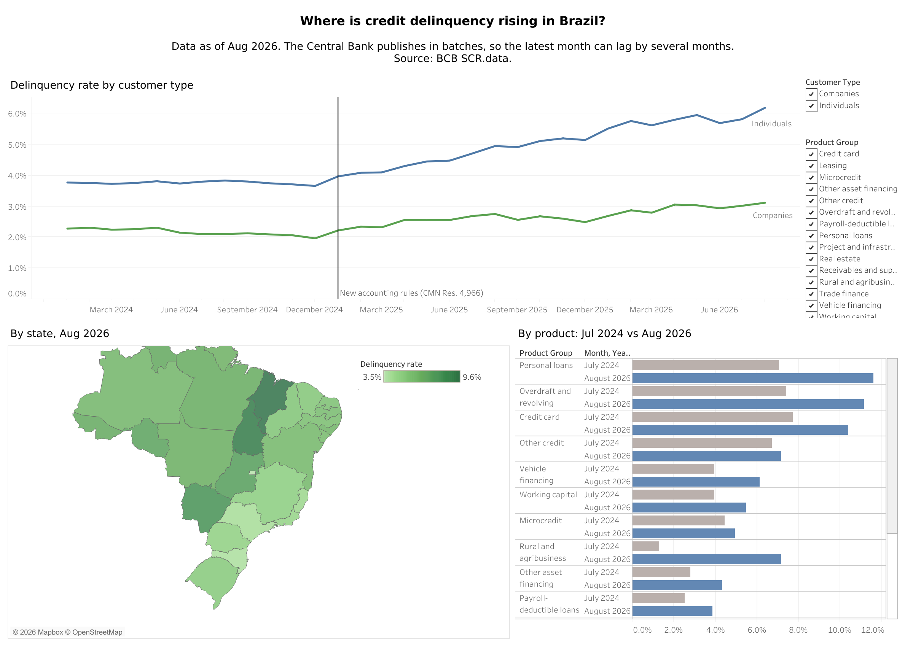

# Brazil Credit Portfolio Analytics

An end-to-end analytics platform built on **SCR.data**, the Banco Central do Brasil's public credit registry: the entire Brazilian financial system's loan portfolio, published by state, customer profile, product and lender type.

**Question it answers:** where is credit delinquency rising, for whom, and in which products?

> **What the data shows (Jul 2024 → Jul 2026):** the system's nonperforming rate rose from **3.1% to 4.8%** while the portfolio grew from R$ 6.3 to R$ 7.6 trillion. The increase is concentrated in individuals (3.8% → 5.8%) and in personal loans without payroll deduction (7.1% → 11.3%); payroll-deductible loans (*consignado*) stayed far lower (2.5% → 3.7%). In the latest month, **August 2026, the rate reached 5.0%**, 0.9 percentage points above a year earlier ([validated summary](docs/summaries/2026-08.md)).
>
> *Brazilian banks adopted new accounting rules (CMN Resolution 4,966) in January 2025, and the Central Bank estimates that about 70% of the rise through June 2025 came from that change, because delinquent loans now stay longer on the books before write-off ([BCB, Monetary Policy Report, Sep 2025](https://www.bcb.gov.br/content/ri/relatorioinflacao/202509/rpm202509b6p.pdf)).*

| | |
|---|---|
| **Data** | Jan 2024 → Aug 2026, ~10 million rows, ~310k rows per month |
| **Stack** | Python · SQL · dbt · Snowflake · DuckDB · Airflow (Astro) · AWS S3 · GitHub Actions · Tableau Public · Claude API |
| **Tests** | 43 dbt tests (reconciliations, grain, completeness, accepted values) and unit tests for the LLM validator, all run in CI; source freshness sized to the BCB release calendar |
| **Outputs** | [Tableau dashboard](https://public.tableau.com/app/profile/lu.za.b.a.morte/viz/BrazilCreditDelinquency/Dashboard12) · [LLM monthly summary](docs/summaries/2026-08.md) · [Novo Desenrola analysis](docs/analysis/desenrola.md) |

## Dashboard

[](https://public.tableau.com/app/profile/lu.za.b.a.morte/viz/BrazilCreditDelinquency/Dashboard12)

**[Open the interactive dashboard on Tableau Public](https://public.tableau.com/app/profile/lu.za.b.a.morte/viz/BrazilCreditDelinquency/Dashboard12)**

Built from `reporting.rpt_delinquency_monthly`. Tableau Public cannot connect to a warehouse, so it reads a CSV extract and no credentials go into the published workbook. The delinquency rate is a calculated field, `SUM(nonperforming) / SUM(outstanding)`, so it stays correct at any level of filtering. See [dashboards/README.md](dashboards/README.md).

## Architecture

```
                    weekly HEAD request (ETag) ──► new batch? ──► GitHub issue  (cloud watcher)
                                │
BCB yearly ZIP ──► ingestion/download_scr.py ──► S3 raw/ (as published) and local landing/
                                │
             Airflow: detect (MD5 vs RAW.LOAD_LOG) ──► load month (one transaction) ──► dbt build
                                │
                       RAW.SCR_DATA (all text, as published, plus file name and load time)
                                │  dbt
            staging ──► marts (star schema) ──► reporting ──┬──► Tableau Public
                              │                             └──► LLM summary, validated claim by claim
                              └──► mart_desenrola_did ──► Novo Desenrola difference in differences
```

| Layer | Schema | What lives there |
|---|---|---|
| Raw | `RAW` | Files loaded as-is, every column as text, plus source file and load time; `LOAD_LOG` with each month's MD5 and row count |
| Staging | `STAGING` | Renamed to English, typed, text cleaned, deduplicated (views) |
| Marts | `MARTS` | Star schema: one fact table and five dimensions, plus the panel for the Desenrola analysis |
| Reporting | `REPORTING` | Aggregated table for the dashboard and the LLM summary |
| Snapshots | `SNAPSHOTS` | SCD Type 2 history of the product grouping |

**Where it runs.** The warehouse was built and run on Snowflake: files PUT to an internal stage and loaded with `COPY INTO`, a key-pair service user with no passwords, separate `dev` and `replay` databases, and Airflow loading both. When the Snowflake trial ended, I kept the Snowflake code paths and moved day-to-day runs to **DuckDB on my machine** (dbt target `local`), which needs no account. The dbt models are the same on both, with `adapter.dispatch` macros where the SQL differs.

## Data model

**Fact:** `fct_credit_portfolio_monthly`, a periodic snapshot. Grain: one row per month × state × customer profile × product × funding (≈310k rows per month).

**Dimensions:** `dim_month`, `dim_state`, `dim_product`, `dim_customer_profile`, `dim_funding` (a junk dimension).

Modeling decisions are documented in [docs/modeling.md](docs/modeling.md). The ones that matter most:

* **Balances are semi-additive.** Outstanding portfolio can be summed across states or products, never across months.
* **Rates are computed after aggregation.** `nonperforming_rate = sum(nonperforming) / sum(outstanding)`, never an average of rates.
* **Revised months replace the whole month.** The fact is incremental with `delete+insert` on the month, so rows that disappear in a revision are removed too.

## Orchestration

Two Airflow DAGs share one file ([orchestration/dags/scr_monthly.py](orchestration/dags/scr_monthly.py)) and decide what to load by **file content, not by the calendar**:

1. **detect:** list the files the source offers and compare each one's MD5 with the last load of that month in `RAW.LOAD_LOG`. New or changed months go on; nothing new ends the run as *skipped*.
2. **load:** one task per month (dynamic task mapping, one at a time). In a single transaction: delete the month, `COPY INTO ... FORCE = TRUE`, record the MD5 and row count. If anything fails, it rolls back and RAW is unchanged.
3. **dbt build:** once, after all months load.

| DAG | Schedule | Source → target |
|---|---|---|
| `scr_monthly` | manual | `replay` folder → `CREDITO_REPLAY` |
| `scr_bcb_weekly` | Mondays 07:00 | BCB site → `CREDITO`. Sends a HEAD request for this year's and last year's ZIPs and downloads only when one changed |

**Why a replay environment.** The BCB does not publish monthly: it releases batches a few times a year (for example Jan-Jul in one release, Aug-Dec the following January). To test the pipeline without waiting months, I cloned the database (Snowflake zero-copy clone, `CREDITO_REPLAY`) and "published" real 2026 files one by one into a landing folder:

| Scenario | What I did | Result |
|---|---|---|
| Several months at once | Dropped a batch of months in one go | One load task per month, one `dbt build` at the end |
| Same file again | Re-ran with nothing new | MD5 matched, run skipped, no rows touched |
| Revised month | Changed a month already loaded | Only that month reloaded; the fact replaced it with `delete+insert` |

A damaged file is covered by design rather than by a replay run: `COPY` runs with `on_error = abort_statement` inside the month's transaction, so a file cut off mid-row fails the load and RAW keeps the previous version.

**Release watcher.** Airflow only runs when my machine is on, so a second check runs in the cloud: [a GitHub Actions workflow](.github/workflows/bcb_release_watch.yml) sends the same HEAD requests every Monday and opens an issue labelled `bcb-release` when a yearly file changes. Source freshness in dbt warns after 210 days and errors after 270, sized to the BCB's batch calendar rather than to a monthly one.

## LLM monthly summary, validated before publishing

[`ai/`](ai/) writes a short monthly summary in English and **publishes only the sentences the warehouse confirms**:

1. **Facts:** a closed catalog of 12 metrics ([ai/metrics.py](ai/metrics.py)), each one a SQL query on the reporting table.
2. **Writing:** the model (Claude Haiku via the Anthropic API) must answer through a forced tool call: every sentence is a claim that names its `metric_id` and `value`.
3. **Validation** ([ai/validate.py](ai/validate.py)): each claim is recomputed with fresh SQL. It is rejected if the metric is unknown, the value differs by more than 0.05, the sentence contains any other number, or it gives the rate of a group (top product, top state) without naming the right group.
4. **Publishing:** accepted claims go to `docs/summaries/YYYY-MM.md`; with fewer than 3, nothing is published.

A real rejection from the first run ([docs/examples/2026-08_first_run.json](docs/examples/2026-08_first_run.json)):

> *"The delinquency rate of individuals (PF) was 6.2% in August 2026, while the rate for companies (PJ) was 3.1%."*
> Rejected: **sentence has 3.1, but the value is 6.19.** One claim, one metric: the extra number could not be checked against the claim it came with, so the sentence was dropped.

```bash
python -m ai.run --dry-run     # facts only, no API call
python -m ai.run               # needs ANTHROPIC_API_KEY; local DuckDB, latest month
```

## Analysis: did the Novo Desenrola lower delinquency?

The families track of Novo Desenrola Brasil (May to Aug 2026) let individuals earning up to five minimum wages renegotiate overdue credit card, overdraft and personal loan debts. I wrote the hypothesis before running anything and tested it with a **difference in differences** (product group × income band × month panel, cell and month fixed effects, weighted by balance, clustered standard errors), from Jan 2025 to stay after the accounting change.

Result: **suggestive evidence of a relative drop of about 1 percentage point among eligible lower-income families, sensitive to the choice of pre-period.** The main specification fails its pre-trend check; the robustness check that passes it was chosen after seeing the data, and it has few clusters. Full write-up, both specifications and the limits in [docs/analysis/desenrola.md](docs/analysis/desenrola.md).

## Data quality

`dbt build` runs 43 tests. Highlights:

| Test | What it protects |
|---|---|
| `assert_portfolio_reconciles` | Outstanding = current + overdue, on every row |
| `assert_buckets_sum_to_totals` | Maturity and overdue buckets add up to their totals |
| `assert_no_balance_lost_between_layers` | Monthly totals match between staging and the fact table |
| `assert_nonperforming_within_outstanding` | Nonperforming balance never exceeds the outstanding balance |
| `not_null` on `dim_product.product_group` | Fails when the BCB publishes a new product the grouping seed doesn't know yet |
| `unique` on the fact's surrogate key | Enforces the declared grain |
| Source freshness | Warns at 210 days without new data, errors at 270 |

Source quirks handled in staging: Brazilian decimal commas, a stray Windows-1252 dash character in some product names, repeated and trailing spaces, and the number of operations published as `-1` when not disclosed (kept as `NULL` plus a flag, so it is never summed by accident).

The reconciliation tests also caught a real inconsistency in the published data: one row in December 2024 whose outstanding balance does not equal current + overdue (off by R$ 3,088.53, 1 row out of 9.7 million). It is documented in [docs/modeling.md](docs/modeling.md#known-source-issues), and the test warns on isolated cases but fails if they become systematic.

## CI

Every pull request runs `dbt build` on GitHub Actions against DuckDB with a 2,000-row sample of real data (`ci/sample/`), plus the unit tests of the LLM validator. CI stays free and needs no credentials.

## Run it

```bash
python -m venv .venv && source .venv/bin/activate
pip install -r requirements.txt
cp .env.example .env            # never commit .env

# Local, no cloud account: DuckDB
python ingestion/download_scr.py --start 2024-01 --end 2026-08 --no-upload
python ingestion/load_local_duckdb.py data/raw/scr_data   # or any folder with scrdata_YYYYMM.csv files
cd dbt && export DBT_PROFILES_DIR=. && dbt deps && dbt build --target local && cd ..

python -m ai.run --dry-run                           # LLM summary facts
python analysis/desenrola_did.py                     # difference in differences
```

**On Snowflake:** run the scripts in `snowflake/` in order (setup, internal stage), load with `ingestion/load_snowflake_stage.py`, then `dbt build --target dev`. **Airflow:** `cd orchestration && astro dev start`; see [orchestration/README.md](orchestration/README.md).

## Repository

| Folder | What is there |
|---|---|
| `ingestion/` | Download from the BCB, change detection, loaders for Snowflake and DuckDB, release watcher |
| `snowflake/` | Setup SQL: warehouse, roles, service user, stages, `COPY INTO` |
| `dbt/` | Staging, marts, reporting, seeds, snapshot and tests |
| `orchestration/` | Astro project with the two DAGs |
| `ai/` | Metric catalog, LLM call, validator, publisher and tests |
| `analysis/` | Novo Desenrola difference in differences |
| `dashboards/` | Export of the reporting table for Tableau |
| `docs/` | Modeling decisions, summaries, analysis and images |

## Roadmap

- [x] Ingestion to S3, Snowflake RAW, dbt staging and star schema, tests, CI
- [x] [Tableau Public dashboard](https://public.tableau.com/app/profile/lu.za.b.a.morte/viz/BrazilCreditDelinquency/Dashboard12)
- [x] Airflow orchestration with change detection, idempotent month reloads and a replay environment
- [x] Weekly cloud watcher for new BCB releases
- [x] LLM monthly summary with claim-level validation against the warehouse
- [x] Novo Desenrola difference in differences
- [ ] Re-run the Desenrola analysis when Sep-Dec 2026 is published (the watcher will open the issue)

## Data source and license

Data: Banco Central do Brasil, [SCR.data](https://dadosabertos.bcb.gov.br/dataset/scr_data), licensed under the [Open Database License (ODbL)](https://opendatacommons.org/licenses/odbl/). The CI sample in `ci/sample/` is a subset of that data under the same license.
