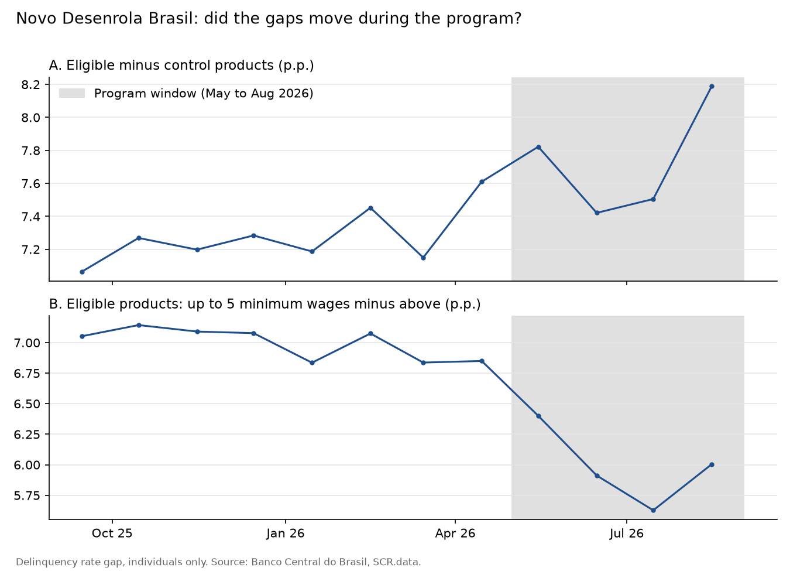

# Did the Novo Desenrola Brasil lower delinquency?

The families track of the program (4 May to 31 Aug 2026) let individuals earning up to five minimum wages renegotiate credit card, overdraft and personal loan debts 91 days to 2 years overdue ([Ministério da Fazenda](https://www.gov.br/fazenda/pt-br/acesso-a-informacao/acoes-e-programas/novo-desenrola-brasil)).

**Hypothesis, written before running the analysis:** delinquency in the eligible group falls relative to a comparison group during the program window.

**Method:** difference in differences on individuals only, from Jan 2025 (after the CMN 4,966 accounting change). Panel of product group × income band × month, cell and month fixed effects, weighted by outstanding balance, standard errors clustered by cell. Model: `dbt/models/marts/mart_desenrola_did.sql`; analysis: `analysis/desenrola_did.py`.

| Comparison | Main spec (pre-period from Jan 2025) | Robustness (pre-period from Sep 2025) |
| --- | --- | --- |
| A. Eligible products vs vehicle and real estate loans | +0.91 p.p. [+0.17, +1.66]; pre-trend fails | +0.37 p.p. [−0.43, +1.18]; pre-trend flat |
| B. Eligible products: up to 5 minimum wages vs above | −0.54 p.p. [−1.47, +0.39]; pre-trend fails | **−1.03 p.p. [−1.83, −0.23]**; pre-trend flat |

**Reading:** in the main spec, neither comparison is valid, because the groups were already drifting apart in early 2025. The income gap within eligible products jumped in Aug 2025 and then stayed flat for eight months, so I added a robustness check with the pre-period starting in Sep 2025. **That check was chosen after seeing the main results.** In it, delinquency among lower-income individuals fell about 1 percentage point relative to higher-income individuals in the same products during the program, with a flat pre-trend. Comparison A shows no detectable effect, consistent with an effect concentrated in the income group that could actually join.

**Conclusion:** suggestive evidence of a relative drop of about 1 p.p. among eligible families, sensitive to the choice of pre-period.

**Limits:**
- The robustness window was chosen after looking at the data.
- Only 6 clusters in comparison B, so the confidence interval is likely too narrow.
- Part of the drop may be mechanical: a renegotiated debt becomes a new, current contract, which does not mean the household is better off.
- The gap rose again in Aug 2026, the last program month. Sep to Dec 2026 will show whether the effect held; the weekly release watcher will flag when they are published.
- The jump in the income gap in Aug 2025 is not explained yet.
- Other measures in the same package (Desenrola Adimplentes from 29 Jun 2026, FGTS-backed credit) may overlap.
